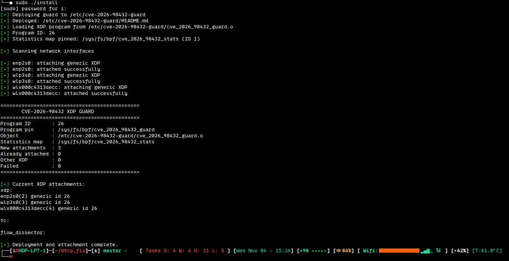

# CVE-2026-98432 — Temporary XDP Mitigation

**Status:** Temporary mitigation — not a permanent fix  
**Platform tested:** Linux / Ubuntu 20.04 (should work upwards)
**Kernel tested:** `5.15.0-124-generic` (Expected to work on newer Linux kernels providing the required eBPF and generic XDP functionality. Compatibility must be verified on the target kernel.)
**Implementation:** eBPF XDP, generic (SKB) mode  
**Date:** 2026-11-03

---

## 1. Purpose

This project provides a *temporary* network-level mitigation for the IPv4/TCP attack surface associated with **CVE-2026-98432**.

The objective is to reduce exposure while a corrected kernel is being prepared, installed and deployed.

The mitigation rejects inbound IPv4 TCP packets containing IPv4 header options. It does this at the XDP ingress hook, before the packet reaches the normal IPv4 and TCP networking stack.

This is deliberately a narrow, fail-open mitigation:

- Matching IPv4/TCP packets with IPv4 options are dropped.
- Other traffic is passed normally.
- Truncated or incomplete IPv4 headers are passed rather than indiscriminately discarded.
- No TCP connection state is maintained.
- No payload inspection or application-layer processing takes place.

**This is not a kernel fix. It is a temporary measure intended to buy time until a corrected kernel has been compiled, installed and boot-tested.**

## 2. Why this mitigation exists

The vulnerable attack surface is associated with handling IPv4 TCP traffic and IPv4 header options.

IPv4 header options are an uncommon feature in ordinary modern network traffic. They include mechanisms such as:

- Record Route (RR)
- Internet Timestamp
- Loose Source Route
- Strict Source Route
- Router Alert
- Other IPv4 option types

The IPv4 header contains a header-length field, IHL, expressed in 32-bit words.

A normal IPv4 header without options has:

`IHL = 5` (20 bytes)

An IPv4 header containing options has:

`IHL > 5` (more than 20 bytes)

The XDP program uses this distinction to reject IPv4 TCP packets with an extended IPv4 header.

This avoids passing that particular packet class into the kernel's normal TCP processing path.

## 3. How the XDP filter works

The program is attached to network interfaces using XDP generic mode.

Its processing sequence is:

1. Read the Ethernet header.
2. Recognise up to two VLAN headers.
3. Identify IPv4 traffic.
4. Check that the fixed IPv4 header is present.
5. Check the IPv4 version and IHL.
6. Check that the complete IPv4 header, including any declared options, is present.
7. If the protocol is TCP and `IHL > 5`, drop the packet.
8. Otherwise, pass the packet to the normal networking stack.

Simplified decision logic:

```c
if (ether_type == IPv4) {
    if (ipv4_header_is_incomplete)
        PASS;

    if (ipv4_version != 4)
        PASS;

    if (ipv4_header_length_is_invalid)
        PASS;

    if (ipv4_protocol == TCP && ipv4_ihl > 5)
        DROP;
}

PASS;
```

The actual implementation also handles up to two VLAN tags.

### XDP actions

| Condition | Action |
|---|---|
| IPv4 TCP, IHL greater than 5 | DROP |
| IPv4 TCP, IHL equal to 5 | PASS |
| IPv4 UDP | PASS |
| Other IPv4 protocols | PASS |
| IPv6 | PASS |
| Non-IP Ethernet traffic | PASS |
| Incomplete/truncated IPv4 header | PASS |

The implementation does not parse TCP options. TCP timestamps, SACK and window scaling are not IPv4 header options and remain unaffected.

## 3b. Why XDP instead of Netfilter or iptables?

This mitigation uses **XDP (eXpress Data Path)** rather than Netfilter/iptables because the objective is to discard matching packets as early as reasonably possible in the Linux networking receive path.

### Packet processing position

With generic XDP (SKB mode), the filter runs at the ingress stage before the packet enters the normal network protocol stack and before Netfilter's usual IPv4 processing hooks.

This has several advantages for this particular mitigation:

- **Early rejection:** IPv4 TCP packets containing IPv4 header options are discarded before normal IPv4 and TCP processing.
- **Reduced processing overhead:** Dropped packets do not continue through subsequent networking layers, including the normal Netfilter processing path.
- **Narrow execution scope:** The program only inspects Ethernet, optional VLAN headers and the relevant IPv4 header fields. It does not require connection tracking, NAT or firewall rule evaluation.
- **Predictable filtering logic:** The decision is based on the IPv4 protocol field and IHL value, making the filter small and straightforward to audit.
- **Independent deployment:** The mitigation is implemented as an eBPF program and does not require modifying existing iptables or nftables firewall rules.

### Why not iptables or Netfilter?

iptables and nftables are perfectly valid ways to implement this same filtering rule. In fact, Netfilter-based filtering is a legitimate alternative and may be preferable where an administrator already manages ingress filtering centrally through the firewall.

However, those mechanisms operate later in the receive path than XDP generic mode.

For this specific use case, filtering before normal IPv4/TCP processing is desirable because the vulnerability concerns the handling of IPv4 TCP packets carrying IPv4 header options.

### Generic XDP (SKB mode)

This project deliberately uses generic XDP rather than driver-specific native XDP.

Generic XDP operates on the SKB-based receive path and therefore provides broader compatibility with network drivers that do not implement native XDP support.

The trade-off is that generic XDP does not provide the same early execution point or performance characteristics as native driver-mode XDP. It should not be confused with hardware-offloaded XDP.

### Design decision

The choice of XDP is not based on the assumption that Netfilter is insecure or unsuitable.

It is based on placing this particular packet filter as early as practical in the Linux receive path, while retaining broad compatibility through generic XDP.

**The objective is to reject the relevant packet class before it reaches the vulnerable IPv4/TCP processing path, not to replace the host firewall.**

## 4. What this mitigation blocks

The filter blocks **all IPv4 TCP packets carrying IPv4 header options**, not just Record Route.

This includes packets containing, for example:

- Record Route
- IPv4 Timestamp
- Loose Source Route
- Strict Source Route
- Router Alert, when carried in an IPv4 TCP packet
- Other IPv4 options

The filter does not distinguish between individual IPv4 option types. It rejects the entire IPv4 TCP packet whenever the IPv4 header length exceeds 20 bytes.

This is intentional: a broad and simple rule is preferable to an incomplete option-type blacklist for this temporary mitigation.

## 5. What it does NOT block

This mitigation has deliberately limited scope.

It does not:

- Fix the vulnerable kernel code.
- Protect interfaces on which the XDP program is not attached.
- Filter IPv4 TCP packets arriving through paths that bypass the attached ingress hooks.
- Filter loopback traffic.
- Filter IPv6 traffic.
- Filter IPv4 UDP or other non-TCP protocols.
- Reject normal IPv4 TCP packets with a 20-byte IPv4 header.
- Inspect TCP options.
- Inspect TCP payloads.
- Detect or prevent unrelated kernel vulnerabilities.
- Replace a kernel security update.

It also does not perform general IP packet validation. Incomplete or malformed packets outside the specific checks implemented by the program may still be passed to the kernel.

**Do not interpret a successful XDP deployment as proof that the host is no longer vulnerable.**

## 6. Statistics

The program uses a per-CPU array map:

`cve_2026_98432_stats`

Map properties:

- Type: `percpu_array`
- Key size: 4 bytes
- Value size: 8 bytes
- Maximum entries: 2

Counters:

| Key | Meaning |
|---|---|
| 0 | IPv4 TCP packets with IPv4 options dropped |
| 1 | Incomplete/truncated IPv4 headers passed |

Because this is a per-CPU map, values are maintained separately for each CPU.

A zero counter does not necessarily indicate a problem. It may simply mean that no matching traffic has been observed.

## 7a Build

The project includes a build script that checks if the current running kernel has BPF support.

### Requirements

- Linux kernel with eBPF syscall support.
- Generic XDP (SKB mode) support.
- Clang/LLVM with BPF target support.
- `bpftool` (for capability inspection).
- Bash and standard build utilities.

### Build procedure

Run from the project directory:

```bash
./build
```

### Build output

The expected output is:

```text
cve_2026_98432_guard.o
xdp_option_probe
```

This is the eBPF object loaded by the installer.

### Architecture portability

The C source is architecture-independent, but the generated object must be compiled using a toolchain capable of producing eBPF bytecode.

The resulting eBPF object is not a native executable for the host CPU. The Linux kernel loads and verifies the eBPF instructions independently of whether the host CPU is x86-64 or ARM64.

### Important

A successful build does not guarantee that the kernel will accept the program.

The kernel's eBPF verifier performs the definitive safety and compatibility checks when the object is loaded.

The deployment should only proceed after successful compilation and verifier acceptance.

## 7b Installation

The installer is:

`install`

The deployment directory is:

`/etc/cve-2026-98432-guard/`

The installer deploys:

- `cve_2026_98432_guard.o`
- `install`
- Optional documentation and checker files, when present

The pinned BPF objects are:

```text
/sys/fs/bpf/cve_2026_98432_guard
/sys/fs/bpf/cve_2026_98432_stats
```

The installer:

1. Checks required tools and permissions.
2. Ensures that BPF filesystem support is available.
3. Loads the program if it is not already pinned.
4. Reuses an existing pinned program rather than silently replacing it.
5. Checks the statistics map.
6. Scans available non-loopback network interfaces.
7. Attaches the program in generic XDP mode where no conflicting XDP program is present.
8. Does not overwrite an unrelated XDP attachment.

Run as root:

```bash
sudo ./install
```

The installer is designed to be repeatable. Running it again should recognise existing attachments rather than attaching duplicate instances.

### Important: replacing an existing program

Copying a newly compiled object into the deployment directory does not automatically replace an already pinned and attached program.

This is intentional. It prevents an ordinary installer run from silently changing the active network filter.

A deliberate reload or migration procedure is required when replacing the active program.

## 8. Verification

The checker is:

`checkinstall`

Run:

```bash
./checkinstall
```

It checks:

- The pinned program.
- The program ID.
- The pinned statistics map.
- Whether the map belongs to the program.
- XDP attachments on available non-loopback interfaces.
- Whether the attached program IDs match the expected program ID.
- The per-CPU statistics.

A healthy installation should report:

```text
Correct attachments: 3
Missing/wrong: 0
Warnings: 0
Errors: 0
INSTALLATION HEALTHY
```

The expected program ID is not a permanent constant. It can change after a deliberate reload.

## 9. Safe functional test

The filter can be tested without exercising the vulnerability.

The test consists of sending one ordinary TCP SYN packet with an IPv4 Record Route option from a separate, controlled machine to an interface on which the filter is attached.

There is no exploit payload, no malformed TCP structure and no attempt to trigger the vulnerability. The purpose is simply to verify that an IPv4 TCP packet with `IHL > 5` is dropped before reaching the normal networking stack.

Requirements:

- Use a second machine under your control.
- Send to an IP address belonging to the protected host.
- Use an unused TCP destination port.
- Do not use a third-party destination.
- Run the test only on a network where you are authorised to transmit packets.

Example using Scapy on the test machine:

```python
#!/usr/bin/env python3

from scapy.all import IP, TCP, IPOption_RR, send

TARGET = "192.0.2.10"  # Replace with the protected host's IP
SOURCE_PORT = 49152
DEST_PORT = 65000

packet = (
    IP(
        dst=TARGET,
        options=[IPOption_RR()],
    )
    /
    TCP(
        sport=SOURCE_PORT,
        dport=DEST_PORT,
        flags="S",
        seq=1,
    )
)

print(f"Sending one benign IPv4/TCP packet to {TARGET}:{DEST_PORT}")
send(packet, count=1, verbose=False)
print("Packet sent.")
```

`192.0.2.10` is a documentation-only example address. Replace it with the actual address of the controlled test host.

On the protected host, inspect the statistics before and after the test:

```bash
sudo bpftool map dump pinned /sys/fs/bpf/cve_2026_98432_stats
```

Expected result:

- Counter key `0` increases by one on the CPU that processed the packet.
- The packet does not reach the normal TCP stack.
- No TCP connection is established.

The counter is per-CPU, so inspect all returned CPU values rather than expecting a single global counter.

A negative result is not conclusive until the packet's ingress interface and the XDP attachment on that interface have been confirmed.

### Normal traffic regression test

After deployment, verify ordinary connectivity:

- DNS resolution
- HTTP and HTTPS
- SSH
- Existing TCP connections
- Wi-Fi and wired connectivity, as applicable

Normal IPv4 TCP traffic without IPv4 options should continue to work.

## 10. Systemd service and reboot persistence

The XDP filter is not inherently reboot-persistent.

Although the program and its statistics map are pinned in `/sys/fs/bpf/`, these pinned objects exist only for the lifetime of the running kernel. They do not survive a system reboot.

After reboot:

- The XDP program is no longer loaded.
- The pinned BPF program and map no longer exist.
- All XDP interface attachments are gone.
- The network interfaces must be attached again.

### Automatic loading through systemd

To make the mitigation reboot-safe, a systemd oneshot service can automatically deploy the filter during system startup.

The service executes the installer:

```text
/etc/cve-2026-98432-guard/install
```

The service should be configured to run after the relevant network devices have been initialised and before normal network operation where practical.

Example unit:

### Enable the service

Install the unit file:

```bash
sudo cp mtcp-guard.service \
    /etc/systemd/system/cve-2026-98432-guard.service
```

Enable it at boot:

```bash
sudo systemctl daemon-reload
sudo systemctl enable cve-2026-98432-guard.service
```

Start it immediately:

```bash
sudo systemctl start cve-2026-98432-guard.service
```

### Service status and diagnostics

Check the service:

```bash
systemctl status cve-2026-98432-guard.service
```

Inspect startup logs:

```bash
journalctl -u cve-2026-98432-guard.service -b
```

### Important limitations

The service only attaches the filter to network interfaces that exist when the installer runs.

Interfaces created or connected later may not automatically receive the XDP attachment. This includes USB network adapters and some dynamically created virtual interfaces.

Additional udev or network-manager integration may be required for systems where interfaces appear after service startup.

`Before=network.target` and `systemd-udev-settle.service` provide startup ordering, but do not guarantee that every possible network interface is available at that point.

### Reboot safety

| Deployment method | Survives reboot? |
|---|---|
| Manual BPF load and attachment | No |
| Pinned BPF objects only | No |
| Installer executed manually | No |
| Installer executed by enabled systemd service | Automatically reloaded at boot |
| Interfaces appearing after service execution | Not automatically covered |

**Conclusion:** The mitigation is reboot-safe only when the systemd service is installed, enabled and successfully executed at every boot. Without that service, the host returns to its unfiltered state after reboot.

## 11. SHA-256 integrity checks

The project includes a `SHA256SUMS` manifest containing SHA-256 hashes of the project files.


```
39c089b872ca11bdb8d827ac774d9e4c93a022b0d2dc030bcdef55e5c1616ff4  ./build
5fc9542cdaf40d3c689cef5aaa300e4028ca02771cb45d10491f1629167b6c86  ./check-bpf-support
7c5c16439f8a9393fcb865f9b0e9287d3cdbdfa8394cd181dfa3cf55552bfc99  ./checkinstall
6c4352f0b062cc8d936c29d1f2ad65b154c0efccaa36c94b0e94d1af9a17b895  ./cve_2026_98432_guard.c
8d4d07a775a80d738f97778831bc518b9ee7985b4a92af91fc9fe436fed0ccd7  ./cve_2026_98432_guard.o
a515ac841aefb090586436c1dadc1e39badc8b4ef7920e93c9a01041b649c22b  ./install
e6c8450ad6f64f05d11be14a14945c9fc7f9217232ddd43cb7d2b68f136f1f75  ./install-service
d317f9b33084554436c19cce47f54d4cea74a0c4e8be98821927517dbc48bd0d  ./mtcp-guard.service
efc78963c6ba695fe83b350629eee01c811f234756549989f371d8e91601ea79  ./xdp_option_probe
3e87e88322c9dabe38d4ff2d4b82e4180c6474ca0da548543e1aed537d94e0db  ./xdp_option_probe.c
52c3597e1ada678f65d00d2490a177a4a7d034e32c693723508bc869dcc492d7  ./xdp_option_probe_auto
```

**Integrity note:** SHA-256 checks detect accidental or unauthorised changes only when the expected manifest is trusted. They do not independently authenticate the author or origin of the files. For stronger provenance, retain a trusted copy of the manifest or sign it with GPG.

## 12. License

GPL-3.0-only LICENSE

## 13. Security disclaimer and limitation of liability

SEE DISCLAIMER

## 14. Support the project ☕

This project is developed and maintained independently.

If this workaround saved you time, helped secure a system, or provided a useful starting point for your own research, consider supporting me.

Donations are entirely voluntary and help cover development time, testing hardware, infrastructure and ongoing maintenance.

Support can be done by ETH, BTC or TRC20 on 
```
[ ETH 0x3c4cc45af4bdd51c050c4e5d194764a9969eaf43 ]
[ BTC bc1qm4kle4s2jvujjjfaxg2uatw868uv4ljafnaj80 ]
[ USDT TRC20 TFU3WS9Y39MhFkmR6sFFNdPD8yvziHM8nw ] 
```

Thank you for supporting independent open-source development!

[](screenshots/001.jpeg)
